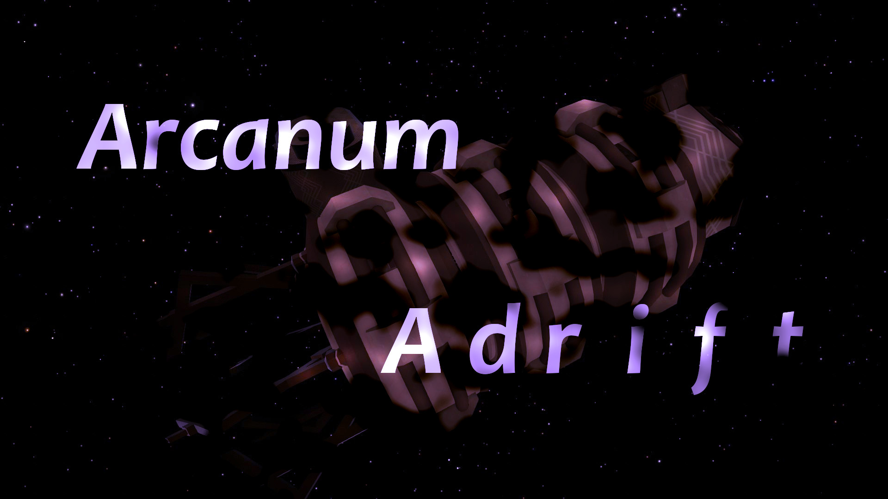

# Arcanum Adrift

A short story mod for Outer Wilds. A Nomai text wall has been added to the Timber Hearth observatory museum, behind the Nomai Statue.

Made for the 2023 New Horizons Jam in a single week, with no custom (runtime) code.

## Known Issues

Tag or message @hawkbar in the Outer Wilds Modding Discord with bug reports or questions!

- You can sometimes fall through the floor after entering certain singularities.
- Some sound effects are very loud. Turn down your headphones or speakers before playing.
- Load times can be extremely slow.
- A major puzzle can be 'cheesed' using the scout. This is not the intended solution.

## The Team

- Hawkbar: Design, Technical Art, Tooling
- Insmoshable: Environment Art, Design

## Translations

- Chinese (Simplified): SanBaiMing
- Japanese: TRSasasusu